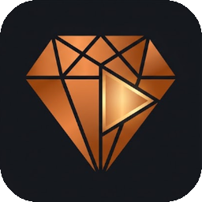
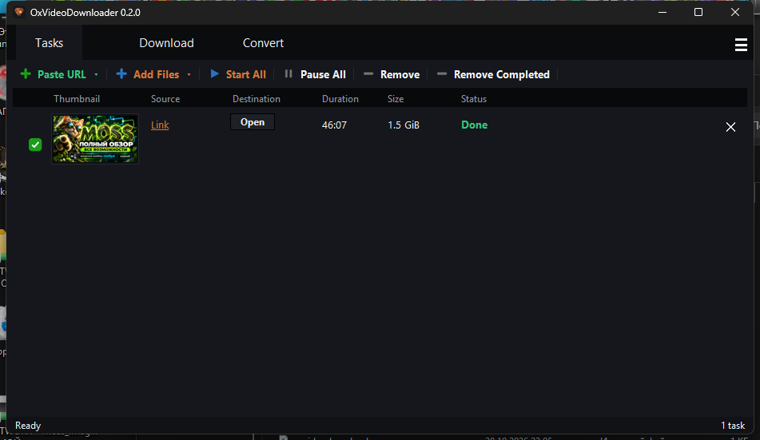

<p align="center">
  
</p>

<h1 align="center">OxVideoDownloader</h1>

<p align="center">
  A portable Windows desktop video downloader and media converter with a modern dark UI.
</p>

<p align="center">
  
  
  
  
  
</p>

<p align="center">
  
</p>

<a id="languages"></a>
<p align="center">
  <a href="#english">🇬🇧 English</a> | <a href="#russian">🇷🇺 Русский</a>
</p>

---

<a id="english"></a>
## 🇬🇧 English

**OxVideoDownloader** is a portable desktop application for Windows that downloads videos, audio tracks, and playlists from over 1,800 websites and converts local media files through a clean, modern dark interface.

### ✨ Features

- **Engine & Queue Management:** Powered by `yt-dlp` and `FFmpeg`. Downloads single videos, audio tracks, and entire playlists from a link. Features a multi-task queue displaying thumbnails, source, duration, file size, status, live transfer speed, and ETA per task, with full controls (`Start All`, `Pause All`, `Restart`, `Remove`, `Remove Completed`).
- **Quality Presets:**
  - **Video:** `Best`, `2160p` (4K), `1440p`, `1080p` (Full HD), `720p` (HD), `480p`, `360p`.
  - **Audio:** `Best`, `~256 kbps`, `~128 kbps`.
- **Convert-While-Downloading:** Remux or transcode on the fly into `MP4`, `MKV`, `WEBM`, `MOV`, or `AVI` containers using `H.264`, `H.265 (HEVC)`, `VP9`, or `AV1` codecs. Supports concurrent segment downloading and browser sign-in cookies for age-restricted or member-only videos.
- **Local Media Converter (`Convert` Tab):** Convert local media files between `MP4`, `MKV`, `WEBM`, `MOV`, `AVI`, `MP3`, `M4A`, `WAV`, and `FLAC`. Includes advanced controls for CRF quality and audio bitrate, with options to convert **Now** or queue for **Later**.
- **100% Portable:** Zero installation and no registry entries—the entire application resides in a single folder and runs directly from a USB stick. `FFmpeg` binaries are not committed to the repository; on first launch, the app checks the local `ffmpeg\` folder and downloads them automatically via a cancelable progress dialog.
- **Customization & Settings:** 5 interface languages (English, Russian, German, Spanish, French), Light and dark **Obsidian Copper** themes, automatic retry for failed downloads, and custom download directory selection.

### 🌐 Supported Sources

| Platform | Domain | Platform | Domain | Platform | Domain |
| :--- | :--- | :--- | :--- | :--- | :--- |
|  **YouTube** | `youtube.com` |  **TikTok** | `tiktok.com` |  **X / Twitter** | `x.com` |
|  **Rutube** | `rutube.ru` |  **Dailymotion** | `dailymotion.com` |  **Instagram** | `instagram.com` |
|  **VK Video** | `vk.com` |  **Vimeo** | `vimeo.com` |  **Facebook** | `facebook.com` |
|  **OK.ru** | `ok.ru` |  **Twitch** | `twitch.tv` |  **Reddit** | `reddit.com` |

*…and 1,800+ more sites thanks to yt-dlp.*

### 📦 Getting Started

Choose one of these installation methods:

1. **Ready-made portable build (recommended):** Download the latest archive from [GitHub Releases](https://github.com/orex2121/OxVideoDownloader/releases), extract it to any writable folder, and run `"OxVideo Downloader.exe"`. The portable package already contains the Python environment, all dependencies, and FFmpeg. No installation is required.
2. **Build from the repository:** Download or clone [the repository](https://github.com/orex2121/OxVideoDownloader), then double-click `INSTALL.bat`. It downloads a self-contained portable CPython 3.12 build (Tkinter included) and extracts it into the local `python\` folder — no installer, no registry entries — then installs the packages from `requirements.txt` and verifies the result. Run `"OxVideo Downloader.exe"` afterward. FFmpeg is downloaded automatically on the first application start.

After either method, the entire application folder can be moved or copied to another Windows x64 computer. A system-wide Python installation is not required.

`python\`, `ffmpeg\`, `config.json`, `tasks.json`, and `.thumbnails\` are intentionally excluded from Git. Therefore a fresh clone is the **source distribution**, not a ready-to-run portable binary package. For a ready-made release, archive the whole folder after running `INSTALL.bat` and completing the first launch.

### 🔄 Updating

1. Close OxVideoDownloader.
2. Double-click `UPDATE.bat` and wait for the success message.
3. Start the application normally.

The updater downloads the latest files from the `main` branch of [the GitHub repository](https://github.com/orex2121/OxVideoDownloader), updates Python dependencies, and preserves the local `python\`, `ffmpeg\`, `config.json`, `tasks.json`, and `.thumbnails\` data. An internet connection is required. Do not interrupt the updater while files are being copied.

### 🗂 Project Layout

```text
├── oxvideodownloader.py   # Application entry point
├── INSTALL.bat             # Builds the local portable Python environment
├── UPDATE.bat              # Updates the application from GitHub
├── update.ps1              # Update implementation used by UPDATE.bat
├── oxvd/
│   ├── core.py            # Download, queue, and FFmpeg conversion logic
│   ├── ui.py              # Tkinter GUI views and components
│   ├── themes.py          # Light and Obsidian Copper theme definitions
│   └── i18n.py            # Localization loader
├── assets/                # App icons and assets/hosters/<domain>.png icons
├── local/                 # 5 language translation files (EN, RU, DE, ES, FR)
├── launcher/
│   └── launcher.cs        # C# source for compiling "OxVideo Downloader.exe"
├── requirements.txt       # Python package dependencies
└── config.json / tasks.json  # Runtime state & queue (auto-created, not committed)
```

### ⚙️ How It Works

`yt-dlp` resolves media URLs, parses playlists, and downloads the selected video and audio streams with concurrent segment fetching. `FFmpeg` then merges separate streams, remuxes containers, or transcodes local and downloaded media to your target codec and quality settings.

### ⚖️ License & Fair Use

`yt-dlp` and `FFmpeg` are distributed and used under their respective open-source licenses. This application is intended solely for downloading and converting content that you own or have explicit permission and legal right to download.

[⬆ Back to language selection](#languages)

---

<a id="russian"></a>
## 🇷🇺 Русский

**OxVideoDownloader** — портативное настольное приложение для Windows с современным тёмным интерфейсом, предназначенное для скачивания видео, аудиодорожек и плейлистов с более чем 1800 сайтов, а также конвертации локальных медиафайлов.

### ✨ Возможности

- **Движок и управление очередью:** Работает на базе `yt-dlp` и `FFmpeg`. Скачивает одиночные видео, аудиодорожки и целые плейлисты по ссылке. Многозадачная очередь отображает превью, источник, длительность, размер файла, статус, текущую скорость загрузки и оставшееся время (ETA) для каждой задачи с полным набором элементов управления (`Start All`, `Pause All`, `Restart`, `Remove`, `Remove Completed`).
- **Пресеты качества:**
  - **Видео:** `Best`, `2160p` (4K), `1440p`, `1080p` (Full HD), `720p` (HD), `480p`, `360p`.
  - **Аудио:** `Best`, `~256 kbps`, `~128 kbps`.
- **Конвертация при скачивании:** Ремультиплексирование (remux) или перекодирование «на лету» в контейнеры `MP4`, `MKV`, `WEBM`, `MOV` или `AVI` с использованием кодеков `H.264`, `H.265 (HEVC)`, `VP9` или `AV1`. Поддерживается многопоточная загрузка сегментов и использование файлов cookie из браузера для видео с возрастными ограничениями или закрытым доступом по подписке.
- **Конвертер локальных файлов (вкладка `Convert`):** Конвертация локальных медиафайлов между форматами `MP4`, `MKV`, `WEBM`, `MOV`, `AVI`, `MP3`, `M4A`, `WAV` и `FLAC`. Включает гибкие настройки качества CRF и битрейта аудио с возможностью запустить конвертацию сразу (**Now**) или добавить в очередь на потом (**Later**).
- **100% портативность:** Не требует установки и не оставляет записей в реестре — всё приложение находится в одной папке и может запускаться напрямую с USB-накопителя. Бинарные файлы `FFmpeg` не включены в репозиторий: при первом запуске приложение проверяет локальную папку `ffmpeg\` и автоматически скачивает их через окно прогресса с возможностью отмены.
- **Персонализация и настройки:** 5 языков интерфейса (английский, русский, немецкий, испанский, французский), светлая и тёмная темы оформления (**Obsidian Copper**), автоматический повтор при сбоях загрузки и выбор пользовательской папки для сохранения файлов.

### 🌐 Поддерживаемые источники

| Платформа | Домен | Платформа | Домен | Платформа | Домен |
| :--- | :--- | :--- | :--- | :--- | :--- |
|  **YouTube** | `youtube.com` |  **TikTok** | `tiktok.com` |  **X / Twitter** | `x.com` |
|  **Rutube** | `rutube.ru` |  **Dailymotion** | `dailymotion.com` |  **Instagram** | `instagram.com` |
|  **VK Video** | `vk.com` |  **Vimeo** | `vimeo.com` |  **Facebook** | `facebook.com` |
|  **OK.ru** | `ok.ru` |  **Twitch** | `twitch.tv` |  **Reddit** | `reddit.com` |

*…и ещё более 1800 сайтов благодаря yt-dlp.*

### 📦 Установка и запуск

Выберите один из двух вариантов установки:

1. **Готовая portable-сборка (рекомендуется):** Скачайте последний архив со страницы [GitHub Releases](https://github.com/orex2121/OxVideoDownloader/releases), распакуйте его в любую доступную для записи папку и запустите `"OxVideo Downloader.exe"`. Готовая portable-сборка уже содержит окружение Python, все зависимости и FFmpeg. Установка не требуется.
2. **Сборка из репозитория:** Скачайте или клонируйте [репозиторий](https://github.com/orex2121/OxVideoDownloader), затем запустите `INSTALL.bat`. Он скачает самодостаточную portable-сборку Python 3.12 (с Tkinter) и распакует её в локальную папку `python\` — без установщика и записей в реестре, — затем установит пакеты из `requirements.txt` и проверит результат. После этого запустите `"OxVideo Downloader.exe"`. FFmpeg будет автоматически скачан при первом запуске приложения.

После установки всю папку приложения можно переносить или копировать на другой компьютер с Windows x64. Системная установка Python там не требуется.

Папки `python\`, `ffmpeg\`, а также `config.json`, `tasks.json` и `.thumbnails\` намеренно исключены из Git. Поэтому свежий clone — это **исходный дистрибутив**, а не готовая portable-сборка. Для готового релиза заархивируйте всю папку после выполнения `INSTALL.bat` и первого запуска.

### 🔄 Обновление

1. Закройте OxVideoDownloader.
2. Запустите `UPDATE.bat` и дождитесь сообщения об успешном завершении.
3. Запустите приложение обычным способом.

Обновлятор скачивает последние файлы из ветки `main` [репозитория GitHub](https://github.com/orex2121/OxVideoDownloader), обновляет зависимости Python и сохраняет локальные папки `python\`, `ffmpeg\`, а также файлы `config.json`, `tasks.json` и `.thumbnails\`. Для обновления требуется интернет. Не прерывайте процесс во время копирования файлов.

### 🗂 Структура проекта

```text
├── oxvideodownloader.py   # Точка входа приложения
├── INSTALL.bat             # Создание локального portable-окружения Python
├── UPDATE.bat              # Обновление приложения с GitHub
├── update.ps1              # Логика обновления для UPDATE.bat
├── oxvd/
│   ├── core.py            # Логика загрузки, очереди и конвертации через FFmpeg
│   ├── ui.py              # Компоненты и экраны графического интерфейса Tkinter
│   ├── themes.py          # Определения светлой темы и тёмной темы Obsidian Copper
│   └── i18n.py            # Загрузчик локализаций
├── assets/                # Иконки приложения и логотипы сервисов в assets/hosters/<domain>.png
├── local/                 # Файлы перевода на 5 языков (EN, RU, DE, ES, FR)
├── launcher/
│   └── launcher.cs        # Исходный код на C# для компиляции "OxVideo Downloader.exe"
├── requirements.txt       # Зависимости пакетов Python
└── config.json / tasks.json  # Состояние и очередь задач (создаются автоматически, вне Git)
```

### ⚙️ Как это работает

`yt-dlp` извлекает прямые ссылки на медиапотоки, обрабатывает плейлисты и скачивает выбранные видео- и аудиодорожки с параллельной загрузкой сегментов. Затем `FFmpeg` объединяет отдельные потоки, меняет контейнер без перекодирования (remux) или транскодирует скачанные и локальные файлы в соответствии с выбранным кодеком и настройками качества.

### ⚖️ Лицензия и добросовестное использование

`yt-dlp` и `FFmpeg` распространяются и используются в соответствии с их собственными лицензиями с открытым исходным кодом. Данное приложение предназначено исключительно для загрузки и конвертации контента, который принадлежит вам или на скачивание которого у вас есть явное разрешение и законное право.

[⬆ Вернуться к выбору языка](#languages)
